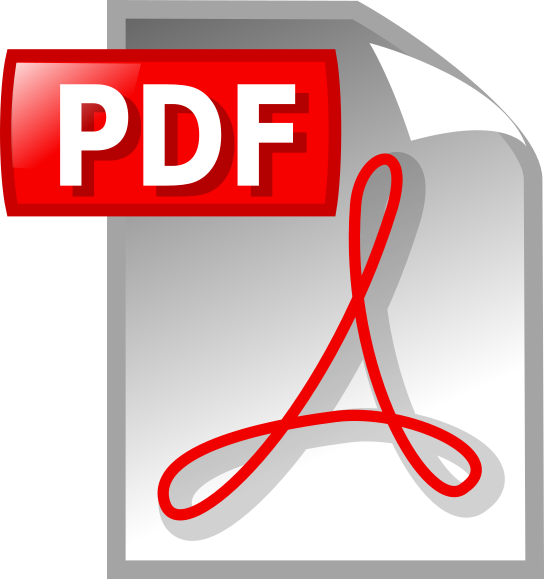

## The 2026 meeting of the LSST AGN Science Collaboration will be hosted in Heraklion, Greece, from Monday 24th to Thursday 28th May.

See[ this page](https://sites.google.com/view/agn-sc-meeting-2026/home) for full details and to register.

## The 2025 July meeting of the LSST AGN Science Collaboration was hosted in Durham, UK, from Monday 14th to Thursday 17th July.

Details of the 2025 meeting are in[ this link](/meeting2025/).

## The 2024 July meeting of the LSST AGN Science Collaboration was hosted by the Planetario di Torino “Attilio Ferrari” in Turin, Italy.

Details of the 2024 meeting are in [this link](https://indico.ict.inaf.it/event/2784/overview).
{: .small}

## The 2023 July meeting of the LSST AGN Science Collaboration was hosted by the National Radio Astronomy Observatory in Charlottesville, Virginia, USA. 

Details of the 2023 meeting are in [this link](https://sites.google.com/view/lsstagnscmeeting/home).
{: .small}

------------------------------------------------------------------------

## The 2022 July meeting of the LSST AGN Science Collaboration was held online, with the program as described below:

#### <u>Supermassive Black Hole Studies with the Legacy Survey of Space and Time - 2022: Getting Ready for Rubin Operations</u>

#### The 2022 Summer Meeting of the LSST Active Galactic Nuclei Science Collaboration: July 26-28, 2022

Note that all times are for USA Eastern time (e.g., for New York City). 

**TUE, JULY 26 - TOTAL TIME IS 4.2 HOURS**

Daily Moderator - G.T. Richards

10:30am - 11:55pm
 10 - Welcome and Organization
 25 - Clarkson - "The Status of the LSST Science Collaborations and Insights for the AGN SC"
 25 - Brandt - "The 2022 State of the LSST AGN Science Collaboration"
 25 - Shemmer - "The LSST AGN Science Collaboration Roadmap"

10 - BREAK

12:05pm - 1:20pm
 25 - AlSayyad - "Update on Science Pipelines and Data Products for the AGN SC"
 25 - Petrecca - "The LSST Data Previews - Current Status Relevant to the AGN SC and Brief Tutorial of the Rubin Science Platform"
 25 - Homayouni - "Census of Black Hole Accretion Structure and Mass with Rubin/LSST"

10 - BREAK 

1:30pm - 2:40pm
 25 - Secunda - "Probing Accretion Disk Structure with LSST"      

 45+ - DISCUSSIONS
        \* SCOC discussion led by Bauer et al.      
        \* Other issues arising from this day's talks        

**WED, JULY 27 - TOTAL TIME IS 4.4 HOURS**

Daily Moderator - D. De Cicco

10:30am - 11:45am
 25 - Verma - "The In-kind process and updates for the AGN SC"
 25 - Czerny - "Emission line time delays from LSST AGN photometry" (In-Kind Contribution)
 25 - Salvato - "MPE photometric redshifts for LSST detected AGN" (In-Kind Contribution)

10 - BREAK

11:55pm - 1:10pm
 25 - Kovacevic - "SER-SAG directable software in-kind contribution to LSST: Report on the construction of a time domain pipeline for periodicity search" (In-Kind Contribution)
 25 - Bongiorno - "Italian simulations of high-z AGN and galaxies in the LSST survey" (In-Kind Contribution)
 25 - Zou - "Multi-wavelength data and spectral energy distributions in the LSST Deep-Drilling Fields"

10 - BREAK

1:20pm - 2:55pm
 25 - Shirley - "Joint photometry from Vera C. Rubin Observatory optical and VISTA near infrared imaging"      
 25 - Lacy - "The host galaxies of low redshift quasars identified in the VLA Sky Survey"

 45+ - DISCUSSIONS
        \* In-kind issues discussion led by Hoenig et al.
           (System readiness; Communication channels; Software access)
        \* Other issues arising from this day's talks        

**THU, JULY 28 - TOTAL TIME IS 4.0 HOURS**

Daily Moderator - M.J. Temple

10:30am - 11:45am 
 25 - Yu - "Building A Comprehensive Dataset in Preparation for LSST AGN Science: AGN Data Challenge and the Next"
 25 - Savic - "The LSST AGN Data Challenge: Selection methods"
 25 - D'Ammando - "Synergies between LSST and CTA for the study of the physics of relativistic jets"

10 - BREAK

11:55pm - 1:10pm
 25 - Charisi - "Multi-messenger observations of supermassive black hole binaries with LSST"
 25 - Hernandez-Garcia - "Updates on services provided by the ALeRCE Broker for AGN science"
 25 - Patel - "Studying the Variability of Quasars as a function of rest-frame wavelength"

10 - BREAK

1:20pm - 2:30pm

 45+ - DISCUSSIONS
        \* Roadmapping issues discussion led by Shemmer et al.
           (Status Review; Priority setting)
        \* Other issues arising from this day's talks        

------------------------------------------------------------------------

## **Supermassive Black Hole Studies with the Legacy Survey of Space and Time (LSST)**

##        A Meeting-in-a-Meeting (MiM) as part of the 236th Meeting of the AAS

## June 1-3, 2020

The Legacy Survey of Space and Time (LSST), to be conducted at the Vera Rubin Observatory beginning in 2023, will enable studies of the growing supermassive black holes (SMBHs) in active galactic nuclei (AGNs) on a truly massive scale. The tens of millions of AGNs discovered will be used for powerful studies of, e.g., the AGN luminosity function, AGN growth across varied cosmic environments, the highest redshift AGNs, AGN variability of many types, and transient SMBH fueling events. The LSST AGN Science Collaboration, currently composed of about 50 members spanning the globe, will lead many investigations of AGNs with LSST and supporting multiwavelength data. The time to prepare for AGN science with the petabyte deluge of LSST data is now, and this Meeting-in-a-Meeting (MiM) aims to stimulate such preparation.

Specifically, this MiM has the following main goals: (1) Provide outreach to the broad AAS membership, so that additional astronomers with interest can learn about the AGN science opportunities with LSST and consider joining the AGN Science Collaboration; (2) Allow in-depth presentation and critical discussion of exciting planned LSST and related AGN science projects; (3) Enable practical planning, coordination, and resource preparation so that these science projects can be executed successfully; and (4) Allow discussion and assessment of the currently evolving LSST observing strategy (e.g., cadence, total depth, footprints), so that key feedback can be provided to the LSST Project.

The MiM program will include 16 talks, each of 30 min duration including time for questions/discussion. The program will begin with a brief review of the LSST Science Collaborations and the LSST AGN Science Collaboration, including its ongoing activities and future plans. This will be followed by talks on AGN selection and characterization using LSST and supporting data, including the science that will be performed with the massive resulting AGN samples. There will then be talks on AGN variability studies using LSST data, including general variability characterization, transient SMBH phenomena, reverberation mapping, and changing-look AGNs. A forward-looking summary, discussion session, and potential hack session will conclude the MiM. In addition to the official allocated sessions, we aim to have several group lunches during the AAS meeting that will enable further discussions and planning.

[The MiM schedule is available.](/sites/default/files/2020-06-lsst-agn-sc-mim-plan01.txt)

For questions or additional information, please email W. Niel Brandt (wnbrandt@gmail.com).

Video recordings of the six MiM sessions are available on YouTube...

   Session 1: https://www.youtube.com/watch?v=vbROQY_88L0
   Session 2: https://www.youtube.com/watch?v=TvSNrO-voa4
   Session 3: https://www.youtube.com/watch?v=qjq0S23Pp6A
   Session 4: https://www.youtube.com/watch?v=3ZFhdX2j2es
   Session 5: https://www.youtube.com/watch?v=mhCdleBWEus
   Session 6: https://www.youtube.com/watch?v=z9wb9bWLfWo

Slides for all the talks can be downloaded at https://www.dropbox.com/s/pzgmumkodg45tfb/2020-06-LSST-MiM-slides01.tar.gz?dl=0

------------------------------------------------------------------------

## **LSST AGN Science Collaboration Session at the LSST 2018 Project and Community Workshop**

**Thursday, August 16, 2018, 11:00 AM - 12:30 PM; Joshua Tree Room (El Conquistador Hilton Resort)**
LSST will enable studies of the growing supermassive black holes (SMBHs) in active galactic nuclei (AGNs) on a truly massive scale - LSST plus multiwavelength data should allow the selection of tens of millions of AGNs. LSST will also provide unmatched source statistics on transient SMBH phenomena including stellar tidal disruptions, strong gravitational microlensing events, blazar flares, changing-look sources, and accretion-disk instabilities. This session covered some of these science prospects and promoted planning for them with connections to the AGN Science Collaboration, the Galaxies Science Collaboration, the Transients Science Collaboration, Informatics and Statistics, and the Project. The session organizers were W.N. Brandt (Chair), Franz Bauer, Gordon Richards, and Michael Strauss.

### Meeting Program

Welcome, Overview, and Activities of the AGN SC
W.N. Brandt, Penn State University

[AGN Selection Opportunities and Challenges with the LSST](/sites/default/files/010-schindler-LSST2018.pdf)
Jan-Torge Schindler, University of Arizona

[Searching for High-Redshift Quasars: An Update from DES and Looking Forward to LSST](/sites/default/files/020-reed-LSST2018.pdf)
Sophie Reed, Princeton University

[LSST Science Expectations and Cadence Needs for Strongly Lensed AGNs](/sites/default/files/030-anguita-LSST2018.pdf)
Timo Anguita, Universidad Andres Bello

[Needed Data-Mining to Prepare for LSST AGN Science and Chilean AGN Follow-Up Capabilities](/sites/default/files/040-bauer-LSST2018.potx)
Franz Bauer, Pontificia Universidad Catolica de Chile

[Session Audio](/sites/default/files/LSST2018-AGN-session-audio.m4a)

[Photo of Session Attendees](/sites/default/files/LSST2018-AGN-session-photo.jpeg)

------------------------------------------------------------------------

## **LSST AGN Science Collaboration Roadmap Development Meeting**

An Open Splinter Meeting as part of the

## [229th AAS Meeting](https://aas.org/meetings/aas229)[, Grapevine, TX](https://aas.org/meetings/aas229)

**Tuesday, January 3, 2017, 9:00 AM - 6:00 PM; Appaloosa 2 (Gaylord Texan Resort & Convention Center)**
The goals of the meeting are to: 1) start the development of a comprehensive Roadmap for the Active Galactic Nuclei (AGN) Science Collaboration of the Large Synoptic Survey Telescope (LSST), presenting a coherent vision for AGN research pre- and post-LSST commissioning, 2) form dedicated Working Groups within the Science Collaboration who will work on specific projects described by the Roadmap, 3) explore funding opportunities to support the highest-ranked projects described by the Roadmap, and 4) encourage eligible active extragalactic researchers to join the AGN Science Collaboration.

### Organizing Committee:

Ohad Shemmer (University of North Texas); <ohad@unt.edu>
Niel Brandt (The Pennsylvania State University); <wnbrandt@gmail.com>
Gordon Richards (Drexel University); <gtr@physics.drexel.edu>

Organizing committee members may be contacted with any questions.

### Meeting Program

#### Session 1: 9:00 - 10:30

#### Chair: Ohad Shemmer, University of North Texas

Welcome and Opening Remarks
Ohad Shemmer, University of North Texas

Description of AGN Science Collaboration Activities and Goals
Niel Brandt, The Pennsylvania State University

[Challenges for Quasar Science with LSST](/sites/default/files/Abstract_Richards.txt) 
Gordon Richards, Drexel University

[Supermassive Black Holes Studies in the Time Domain with LSST](/sites/default/files/Abstract_Mundell.txt) 
Carole Mundell, University of Bath

[A Review of AGN Variability Studies using Survey Data: Prospects for LSST](/sites/default/files/Abstract_MacLeod.txt) 
Chelsea MacLeod, Harvard-Smithsonian Center for Astrophysics

#### Coffee Break: 10:30 - 11:00  [Group Photo](/sites/default/files/IMG_2086.JPG)

#### Session 2: 11:00 - 12:30

#### Chair: Niel Brandt, The Pennsylvania State University

[The AGN Population in the LSST Era](/sites/default/files/Abstract_Assef.txt) 
Roberto Assef, Universidad Diego Portales

[Quasar Astrometric Redshifts with LSST](/sites/default/files/Abstract_Peters.txt) 
Christina Peters, University of Toronto

[Extracting Information From AGN Variability: an LSST AGN Collaboration Proposal](/sites/default/files/Abstract_Kasliwal.txt) 
Vishal Kasliwal, University of Pennsylvania and Princeton University

[Characterization of AGN Variability in the Optical and Near Infrared Regimes](/sites/default/files/Abstract_Sanchez.txt) 
Paula Sanchez, Universidad de Chile

[Constraining Black Hole Accretion Disks by Detecting Time Lags Between
 Quasar Continuum Emission Bands](/sites/default/files/Abstract_Jiang.txt) 
Yan-Fei Jiang, University of California, Santa Barbara

#### Lunch Break: 12:30 - 1:30

#### Session 3: 1:30 - 3:00

#### Chair: Ohad Shemmer, University of North Texas

Discussion and Ranking of AGN Science Collaboration Tasks and
Priorities, Forming Working Groups, and Setting a Timeline for Roadmap
White Paper Posting

#### Coffee Break: 3:00 - 3:30

#### Session 4: 3:30 - 6:00

#### Chair: Gordon Richards, Drexel University

Writing Roadmap White Paper Skeleton

This meeting is kindly supported by the LSST Corporation

