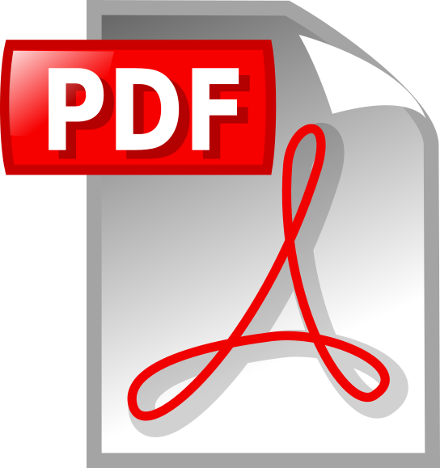

Date: Tuesday, January 3, 2017, 9:00 AM - 6:00 PM
Venue: Appaloosa 2, Gaylord Texan Resort & Convention Center, Grapevine, TX, USA
An Open Splinter Meeting as part of the [229th AAS Meeting](https://aas.org/meetings/aas229).

The goals of the meeting are to: 1) start the development of a comprehensive Roadmap for the Active Galactic Nuclei (AGN) Science Collaboration of the Large Synoptic Survey Telescope (LSST), presenting a coherent vision for AGN research pre- and post-LSST commissioning, 2) form dedicated Working Groups within the Science Collaboration who will work on specific projects described by the Roadmap, 3) explore funding opportunities to support the highest-ranked projects described by the Roadmap, and 4) encourage eligible active extragalactic researchers to join the AGN Science Collaboration.

### Organizing Committee:

Ohad Shemmer (University of North Texas); <ohad@unt.edu>
Niel Brandt (The Pennsylvania State University); <wnbrandt@gmail.com>
Gordon Richards (Drexel University); <gtr@physics.drexel.edu>

Organizing committee members may be contacted with any questions.

### Meeting Program

#### Session 1: 9:00 - 10:30

#### Chair: Ohad Shemmer, University of North Texas

Welcome and Opening Remarks
Ohad Shemmer, University of North Texas

Description of AGN Science Collaboration Activities and Goals
Niel Brandt, The Pennsylvania State University

[Challenges for Quasar Science with LSST](/sites/default/files/Abstract_Richards.txt) 
Gordon Richards, Drexel University

[Supermassive Black Holes Studies in the Time Domain with LSST](/sites/default/files/Abstract_Mundell.txt) 
Carole Mundell, University of Bath

[A Review of AGN Variability Studies using Survey Data: Prospects for LSST](/sites/default/files/Abstract_MacLeod.txt) 
Chelsea MacLeod, Harvard-Smithsonian Center for Astrophysics

#### Coffee Break: 10:30 - 11:00  [Group Photo](/sites/default/files/IMG_2086.JPG)

#### Session 2: 11:00 - 12:30

#### Chair: Niel Brandt, The Pennsylvania State University

[The AGN Population in the LSST Era](/sites/default/files/Abstract_Assef.txt) 
Roberto Assef, Universidad Diego Portales

[Quasar Astrometric Redshifts with LSST](/sites/default/files/Abstract_Peters.txt) 
Christina Peters, University of Toronto

[Extracting Information From AGN Variability: an LSST AGN Collaboration Proposal](/sites/default/files/Abstract_Kasliwal.txt) 
Vishal Kasliwal, University of Pennsylvania and Princeton University

[Characterization of AGN Variability in the Optical and Near Infrared Regimes](/sites/default/files/Abstract_Sanchez.txt) 
Paula Sanchez, Universidad de Chile

[Constraining Black Hole Accretion Disks by Detecting Time Lags Between
 Quasar Continuum Emission Bands](/sites/default/files/Abstract_Jiang.txt) 
Yan-Fei Jiang, University of California, Santa Barbara

#### Lunch Break: 12:30 - 1:30

#### Session 3: 1:30 - 3:00

#### Chair: Ohad Shemmer, University of North Texas

Discussion and Ranking of AGN Science Collaboration Tasks and
Priorities, Forming Working Groups, and Setting a Timeline for Roadmap
White Paper Posting

#### Coffee Break: 3:00 - 3:30

#### Session 4: 3:30 - 6:00

#### Chair: Gordon Richards, Drexel University

Writing Roadmap White Paper Skeleton

This meeting is kindly supported by the LSST Corporation
